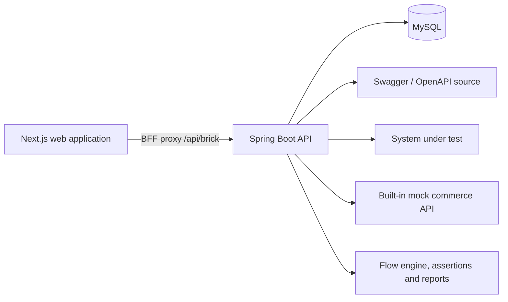

# Brick Platform Backend

[](https://github.com/graham-gc/brick-platform-backend/actions/workflows/ci.yml)

Brick Platform is an API workflow automation backend. It imports Swagger/OpenAPI definitions, resolves nested schemas, composes endpoints into executable flows, carries response data into downstream requests, evaluates business assertions, and retains detailed run history.

The companion web application is available in [brick-platform-frontend](https://github.com/graham-gc/brick-platform-frontend).

## What it demonstrates

- Swagger 2.0 and OpenAPI 3 document validation, import, checksum-based synchronisation, and endpoint discovery
- Document-scoped schema storage with recursive `$ref` resolution
- Directed API workflow execution with branching and `ALL`/`ANY` join strategies
- Flow-scoped response extraction using JSONPath and downstream binding to body, query, path, and header fields
- Shared flow headers alongside node-specific headers
- Separate transport and business outcomes: HTTP execution can succeed while assertions fail
- Status-code, JSONPath, response-header, and response-time assertions with immutable execution snapshots
- Test-suite execution, run history, failed-flow reruns, and node-level request/response diagnostics
- Consistent JSON errors with meaningful HTTP status codes and validation at the API boundary
- Health and service information endpoints for operational checks
- Generated OpenAPI documentation with an interactive, categorised Swagger UI
- End-to-end `X-Request-ID` correlation and duration-aware request completion logs
- A self-contained mock commerce API for a reproducible end-to-end demonstration

## Architecture



## Technology

- Java 8, Spring Boot 2.7, Spring MVC
- MyBatis and MySQL 8
- Apache HttpClient, JsonPath, Jackson, and Fastjson
- springdoc-openapi and Swagger UI
- JUnit 5 and Mockito
- Maven

## Run locally

### Quick start with Docker

The repository includes a complete Docker Compose environment for MySQL, the Spring Boot API, the built-in mock commerce service, and the Next.js frontend.

Prerequisites: Docker Desktop or Docker Engine with Docker Compose v2.

```bash
cp .env.example .env
docker compose up --build
```

The default frontend build context is the public `brick-platform-frontend` GitHub repository. When both repositories are available locally, set `FRONTEND_BUILD_CONTEXT` in `.env` to the absolute path of the frontend repository before starting the stack.

Once all services are healthy:

| Service | URL |
| --- | --- |
| Web application | `http://localhost:3000` |
| Backend health | `http://localhost:8080/api/actuator/health` |
| Backend information | `http://localhost:8080/api/actuator/info` |
| Swagger UI | `http://localhost:8080/api/swagger-ui.html` |
| OpenAPI JSON | `http://localhost:8080/api/v3/api-docs/brick-platform` |
| Mock OpenAPI document | `http://localhost:9090/openapi.json` |
| MySQL | `localhost:3307` |

Stop the services without deleting data:

```bash
docker compose down
```

For a completely fresh demonstration database, run `docker compose down -v`. This permanently removes the Compose-managed MySQL volume.

### Manual setup

#### Prerequisites

- JDK 8
- Maven 3.8 or later
- MySQL 8

#### 1. Initialise the database

The schema script creates the `brick_platform` database and all required tables.

```bash
mysql -u root -p < src/main/resources/schema.sql
```

#### 2. Configure the database connection

Credentials are deliberately not committed. Export them in the terminal or configure the same variables in the IDE run configuration.

```bash
export DB_USERNAME=root
export DB_PASSWORD=your-local-mysql-password
```

Optional configuration:

| Variable | Default | Purpose |
| --- | --- | --- |
| `DB_URL` | `jdbc:mysql://localhost:3306/brick_platform?...` | JDBC connection URL |
| `SERVER_PORT` | `8080` | Spring Boot HTTP port |
| `APP_TIME_ZONE` | `Pacific/Auckland` | API date/time zone |
| `APP_VERSION` | `1.0-SNAPSHOT` | Version exposed by the service information endpoint |
| `MOCK_COMMERCE_ENABLED` | `true` | Start the built-in demonstration API |
| `MOCK_COMMERCE_PORT` | `9090` | Demonstration API port |
| `APP_LOG_LEVEL` | `INFO` | Application logging level |

#### 3. Start the backend

```bash
mvn spring-boot:run
```

The Brick API is served from `http://localhost:8080/api/brick`. With the default settings, the mock API specification is available at `http://localhost:9090/openapi.json`.

Operational checks are exposed at `http://localhost:8080/api/actuator/health` and `http://localhost:8080/api/actuator/info`. Interactive API documentation is available at `http://localhost:8080/api/swagger-ui.html`, with the generated specification at `http://localhost:8080/api/v3/api-docs/brick-platform`.

### Request tracing

Every HTTP response includes an `X-Request-ID`. Clients may supply a safe correlation ID containing letters, digits, `.`, `_`, or `-`; otherwise the backend generates a UUID. The same value is included in application logs so a failed browser request can be matched to its server-side execution.

```bash
curl -i \
  -H 'X-Request-ID: local-demo-001' \
  http://localhost:8080/api/brick/mappings
```

Access logs record the method, URI, response status, and duration without logging request bodies, query values, credentials, or tokens.

## Reproduce the demo

1. Start this backend and the companion frontend.
2. Create a Swagger Mapping using `http://localhost:9090/openapi.json`, environment `dev`, and version `local`.
3. Synchronise the mapping and inspect the imported request, response, and nested schema definitions.
4. Create a flow such as `Login -> List Products -> Create Order -> Pay Order -> Get Order`.
5. Extract the login token, product ID, and order ID as flow variables and bind them into downstream headers, bodies, and paths.
6. Add transport and business assertions, execute the flow, and inspect the node-level report or add the flow to a Test Suite.

The mock login accepts `demo.user` / `demo-password`. Protected endpoints expect `Authorization: Bearer mock-access-token`.

## Tests

```bash
mvn test
```

The test suite covers Swagger parsing, recursive schema resolution, context-variable extraction, HTTP execution, branching, assertions, flow copying, run snapshots, mapper SQL, test-suite orchestration, generated API metadata, and request correlation.

GitHub Actions runs the complete Maven verification and builds the production container image for pushes to `main` and pull requests.

## Repository layout

```text
src/main/java/apiworkflow/
  controller/   HTTP endpoints
  execution/    flow context, HTTP and assertion engines
  mapper/       MyBatis data access
  service/      application services
  swagger/      Swagger/OpenAPI parsing and schema resolution
  mock/         reproducible commerce API
src/main/resources/
  mapper/       MyBatis XML statements
  schema.sql    complete MySQL schema
examples/       demonstration OpenAPI document
```

## Current scope

This is a portfolio reconstruction of an internal engineering-efficiency platform. It intentionally contains no former-employer source code, infrastructure details, production data, or proprietary identifiers. Authentication and multi-tenant access control are outside the current demonstration scope.
