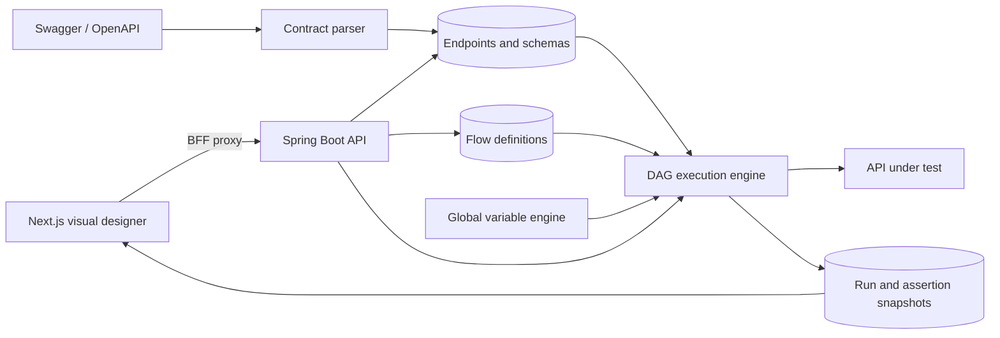
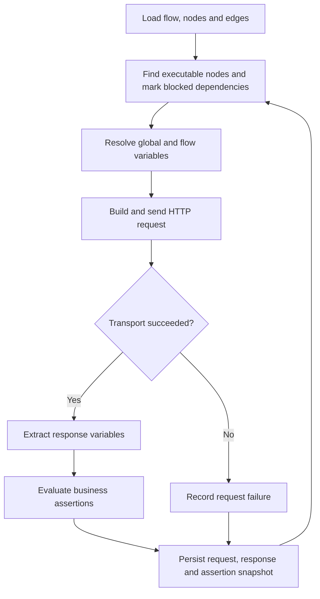

# Brick Platform Backend

[](https://github.com/graham-gc/brick-platform-backend/actions/workflows/ci.yml)

Brick Platform turns Swagger/OpenAPI contracts into executable API workflows. Users can import endpoint definitions, compose them as a directed graph, pass response data between nodes, apply transport and business assertions, and inspect a complete execution history.

This repository contains the Spring Boot execution service. The visual application is in [brick-platform-frontend](https://github.com/graham-gc/brick-platform-frontend).

## Documentation

- [OpenAPI preview requirements (Chinese)](docs/openapi-impact-preview-requirements.md): how the preview distinguishes checked, affected, and unassessed references.
- [Development guide](docs/development.md): local and Docker setup, service addresses, source map, execution semantics, and troubleshooting.
- [Flow save contract](docs/flow-save-frontend-contract.md): the implemented frontend/backend contract, including temporary IDs, assertions, responses, and acceptance checks.
- [Frontend development guide](https://github.com/graham-gc/brick-platform-frontend/blob/main/docs/development.md): the BFF proxy, canvas state, and UI checks.

## Project background

Brick is a clean-room portfolio reconstruction of an internal engineering-productivity platform that I independently designed and delivered while working in a commercial technology team.

The original internal implementation reached usable production status within one week and stable team-wide use within one month. It supported approximately 30 applications, 4,000 API definitions, and more than 800 test flows. A test suite containing roughly 400–500 flows could run unattended in about five minutes, replacing repetitive script-by-script execution and centralising test assets and reports.

This public implementation recreates the system design and core workflow using new code, mock services, and synthetic data. It contains no former-employer source code, production data, credentials, infrastructure details, or proprietary identifiers.

### Problem and outcome

API checks previously existed as separate scripts that had to be started and managed manually. The engineering problem was therefore not simply “send an HTTP request”; it was to make existing test assets discoverable, composable, repeatable, and understandable to other users. Brick moved that work into a shared workflow: import the contract, compose a flow, run it unattended, and review one report.

### Engineering approach

- **End-to-end ownership:** requirements discovery, technical design, implementation, testing, rollout, and operational support were handled as one delivery lifecycle.
- **Practical problem-solving:** the design prioritises the workflow bottlenecks that affected users—reusing endpoints, transferring data, reducing manual execution, and diagnosing failures.
- **Clear handover:** architecture diagrams, explicit design decisions, a mock service, repeatable setup, and automated checks make the repository reviewable by another engineer.
- **Safe defaults:** credentials stay outside source control, logs avoid sensitive payloads, SQL variables are read-only, and the public project contains synthetic data only.
- **Maintainable scope:** enterprise identity and distributed scheduling are documented as future boundaries rather than represented by incomplete placeholder features.

## Product preview

The companion frontend provides the visual contract-to-execution workflow. Its [README contains the complete screenshot walkthrough](https://github.com/graham-gc/brick-platform-frontend#product-preview).


## What this project demonstrates

### Contract ingestion

- Swagger 2.0 and OpenAPI 3 validation from a URL or uploaded JSON document
- Checksum-based synchronisation and endpoint discovery
- Mapping-scoped schema storage instead of duplicating schemas for every endpoint
- Recursive `$ref` expansion for nested request, parameter, and response definitions
- Read-only sync preview that links removed response fields to saved flow variables and assertions

### Workflow execution

- Directed flow execution with branching and configurable `ALL` / `ANY` joins
- Multiple independent nodes referencing the same endpoint definition
- Flow-scoped response extraction using JSONPath
- Downstream binding into request bodies, query parameters, path parameters, and headers
- Shared flow headers plus node-specific header overrides
- Static values, stored Cookie values, JavaScript functions, and read-only database-query variables using `${{...}}`

### Verification and diagnostics

- Separate transport and business outcomes: a successful HTTP exchange can still fail its assertions without being misreported as a request failure
- Status-code, JSONPath, response-header, and response-time assertions
- Immutable node and assertion snapshots for each execution
- Run history, failed-flow reruns, test-suite orchestration, and node-level request/response diagnostics
- A CI command-line runner for saved flows and test suites, with assertion-aware release gates, JUnit reports, and JSON summaries
- Consistent JSON errors, request validation, and end-to-end `X-Request-ID` correlation

### Reproducible demonstration

- A built-in commerce API with login, products, orders, and payment endpoints
- A bundled OpenAPI document containing nested schemas and realistic variable-transfer paths
- Docker Compose for the frontend, backend, MySQL, and mock service
- Generated OpenAPI documentation and an interactive Swagger UI

## Architecture



### Execution lifecycle

Runs execute synchronously in the calling HTTP request. The current scheduler processes ready nodes sequentially, and a Test Suite processes its flows in order. Branching describes dependency relationships; it does not imply parallel execution. `ALL` and `ANY` joins use request-execution status. An assertion failure is reported separately and does not block downstream nodes.



## Selected design decisions

| Decision | Reason |
| --- | --- |
| Keep `flow_node.id` separate from `endpoint_definition.id` | The same endpoint can appear multiple times in one flow with different inputs, assertions, and outgoing edges. |
| Store schemas against a Swagger mapping | OpenAPI schemas are document-scoped and can be referenced recursively by many endpoints. |
| Separate transport status from assertion status | HTTP success and business correctness answer different questions and must remain diagnosable independently. |
| Persist execution snapshots | Historical reports remain meaningful even after a flow or assertion definition changes. |
| Use explicit variable bindings | Interactive source/target configuration is safer and easier to review than hidden string substitution. |
| Restrict database variables to backend-managed sources and read-only SQL | Credentials remain server-side, parameters are bound rather than interpolated, and workflow execution cannot mutate data. |

## Technology

- Java 8 and Spring Boot 2.7
- Spring MVC, Bean Validation, and Actuator
- MyBatis and MySQL 8
- Apache HttpClient, JsonPath, Jackson, and Fastjson
- Nashorn with host access disabled for bounded JavaScript variable functions
- springdoc-openapi and Swagger UI
- JUnit 5, Mockito, and H2 for isolated query tests
- Maven, Docker, and GitHub Actions

## Quick start

The fastest way to review the complete project is Docker Compose.

### Prerequisites

- Docker Desktop or Docker Engine with Docker Compose v2

### Start the complete stack

```bash
cp .env.example .env
docker compose up --build
```

By default, Compose builds the public frontend repository directly from GitHub. When both repositories are available locally, set `FRONTEND_BUILD_CONTEXT` in `.env` to the absolute frontend directory.

For a one-command override, run this from the backend checkout:

```bash
FRONTEND_BUILD_CONTEXT=/absolute/path/to/brick-platform-frontend docker compose up --build
```

The following addresses assume the default ports in `.env.example`:

| Service | URL |
| --- | --- |
| Web application | `http://localhost:3000` |
| Backend health | `http://localhost:8080/api/actuator/health` |
| Backend information | `http://localhost:8080/api/actuator/info` |
| Swagger UI | `http://localhost:8080/api/swagger-ui.html` |
| Generated OpenAPI JSON | `http://localhost:8080/api/v3/api-docs/brick-platform` |
| Mock commerce OpenAPI, as reached by the backend | `http://localhost:9090/openapi.json` |
| MySQL | `localhost:3307` |

The mock is started inside the backend process and binds to `127.0.0.1`. In Docker, import its URL through **Swagger Mappings**; the backend can fetch its own loopback address. The published `9090` port does not make this loopback listener reachable directly from the host. Use the backend health endpoint and Brick's import workflow to check the stack.

Compose initialises `schema.sql` only when its MySQL data directory is empty. An existing database volume is retained across restarts; editing the schema file does not migrate existing tables. See [database lifecycle](docs/development.md#database-lifecycle).

Stop the stack while retaining its data:

```bash
docker compose down
```

Use `docker compose down -v` only when a completely fresh demonstration database is required; it deletes the Compose-managed MySQL volume.

## Ten-minute product walkthrough

1. Open `http://localhost:3000/mappings`.
2. Create a mapping from `http://localhost:9090/openapi.json` using environment `dev` and version `local`. The backend fetches this URL and creation automatically imports the endpoints.
3. Inspect the imported endpoint and recursively resolved schema definitions. Use synchronisation later to refresh an existing mapping.
4. Create a flow: `Login -> List Products -> Create Order -> Pay Order -> Get Order`.
5. Extract the login token, product ID, and order ID, then bind them into downstream headers, request bodies, and path parameters.
6. Add transport and business assertions, execute the flow, and inspect the result drawer and run history.
7. Add the flow to a Test Suite to demonstrate unattended multi-flow execution.

The mock login accepts `demo.user` / `demo-password`. Protected endpoints expect `Authorization: Bearer mock-access-token`.

### Global-variable examples

Create and enable these variables in **Global Variables** before referencing them; the names below are examples, not seeded built-ins. The UI currently disables the unimplemented `BUILTIN` type.

```text
${{baseUrl}}
${{sessionCookie}}
${{randomString(8)}}
${{orderStatus("ORD-001")}}
```

Function variables execute a user-defined JavaScript function body with declared parameters. Database-query variables select a backend-configured data source and execute a single parameterised, comment-free `SELECT`; queries have a five-second timeout and a 1,000-row limit.

## Manual development setup

### Prerequisites

- JDK 8 (the code imports `jdk.nashorn` directly; a newer JDK is not a drop-in replacement)
- Maven 3.8 or later
- MySQL 8

### Initialise and configure MySQL

```bash
mysql -u root -p < src/main/resources/schema.sql
export DB_USERNAME=root
export DB_PASSWORD=your-local-mysql-password
```

Optional environment variables:

| Variable | Default | Purpose |
| --- | --- | --- |
| `DB_URL` | `jdbc:mysql://localhost:3306/brick_platform?...` | JDBC connection URL |
| `SERVER_PORT` | `8080` | Spring Boot port |
| `APP_TIME_ZONE` | `Pacific/Auckland` | API date/time zone |
| `APP_VERSION` | `1.0-SNAPSHOT` | Service version metadata |
| `MOCK_COMMERCE_ENABLED` | `true` | Start the demonstration API |
| `MOCK_COMMERCE_PORT` | `9090` | Demonstration API port |
| `APP_LOG_LEVEL` | `INFO` | Application logging level |

Start the backend:

```bash
mvn spring-boot:run
```

The main API is served from `http://localhost:8080/api/brick`.

Spring Boot does not automatically load the Compose `.env` file. Export the database variables in the shell used to start Maven. The native default is MySQL port `3306`; the database published by Compose defaults to `3307`, so set `DB_URL` accordingly when mixing a native backend with a Docker database. A complete command sequence is in the [development guide](docs/development.md#native-development-with-a-docker-database).

## Run saved tests in CI

Use Python 3.9 or later; no Python packages need to be installed. The command runs tests already saved in Brick. Endpoint addresses, variables, headers, and assertions continue to come from those saved definitions.

```bash
python3 scripts/brick_run.py \
  --base-url http://localhost:8080/api/brick \
  --suite-id 12 \
  --operator ci \
  --web-base-url http://localhost:3000 \
  --timeout 900 \
  --report-dir brick-reports
```

Replace the suite ID with your saved suite's ID. To run a single flow, use `--flow-id 7` instead of `--suite-id 12`. `--base-url` is the complete backend API prefix; it can also be supplied through `BRICK_API_BASE_URL`. The optional `--web-base-url` is the frontend address used to link each flow to its execution history.

| Exit code | Meaning |
| --- | --- |
| `0` | Every flow satisfies the selected gate policy. |
| `1` | A request failed, a node was blocked, an assertion failed, or a flow had no assertions under the default policy. |
| `2` | Verification could not be completed reliably: invalid configuration, API/network failure, timeout, missing records, or unevaluated assertions. |

Every flow must execute successfully and pass its configured assertions. Helper nodes may have no assertions, but an entire flow without assertions fails the default gate. For intentional connectivity checks, `--allow-no-assertions` permits these flows while marking them **skipped** in JUnit and `no_assertions_allowed` in JSON. This option never bypasses a failed or unevaluated assertion. A suite is checked flow by flow, so its aggregate business status cannot hide an unverified child.

The report directory contains:

- `results.xml`: JUnit XML with one test case per flow, plus runner errors when the result set is incomplete. CI tools can ingest this file through their JUnit integration.
- `summary.json`: the gate verdict, exit code, target and run IDs, policy, flow outcomes, failed node/assertion snapshot IDs, and optional Brick links.

Reports exclude request/response payloads, assertion values, and credentials. Open the linked Brick run for full diagnostics. If a gateway in front of Brick requires bearer authentication, supply `BRICK_API_TOKEN` through your CI secret environment; the runner does not add an identity system to Brick.

The timeout covers the complete API exchange and result collection. Execution requests are sent once and are never automatically retried. A timed-out request may still be running in Brick; the runner does not cancel it. Known running IDs are polled without starting another execution. Use a separate report directory for each concurrent invocation.

A [GitHub Actions example](examples/ci/github-actions.yml) runs a selected saved suite and retains both reports even on failure using [GitHub's artifact action](https://github.com/actions/upload-artifact). Copy it into `.github/workflows/` and configure the service addresses. The CI worker must be able to reach Brick, and Brick must be able to reach the configured application under test; use a worker on the appropriate network for private services. This example can be used after a deployment step in your release workflow.

## Testing and CI

```bash
mvn test
python3 -m unittest discover -s scripts/tests -v
```

The automated suite covers contract parsing, recursive schema resolution, variable extraction and binding, global functions, read-only database variables, HTTP execution, branching, assertions, flow copying, execution snapshots, test-suite orchestration, mapper SQL, API metadata, and request correlation.

Tests use mocks, H2, and a temporary loopback HTTP server; they do not require a running MySQL instance. The HTTP tests need permission to bind a local ephemeral port. On 2026-11-04, all 72 tests passed with JDK 8. This is a dated local baseline, not an end-to-end UI or Docker verification.

The Python tests exercise the actual command against a temporary local API fixture: flow/suite gates, business failures, missing snapshots, report contents, timeouts, and prevention of duplicate execution requests. They need a local ephemeral port and do not require a database or running Brick instance.

GitHub Actions runs Maven verification, checks the CI runner, and builds the production container image on pushes to `main` and pull requests.

## Request tracing

Every response contains `X-Request-ID`. A client can provide a safe correlation ID containing letters, digits, `.`, `_`, or `-`; otherwise the backend generates a UUID. The same ID appears in application logs.

```bash
curl -i \
  -H 'X-Request-ID: local-demo-001' \
  http://localhost:8080/api/brick/mappings
```

Completion logs include method, URI, status, and duration without recording request bodies, query values, credentials, or tokens.

## Repository layout

```text
src/main/java/apiworkflow/
  controller/   HTTP API and validation boundary
  execution/    DAG context, variables, HTTP and assertion engines
  mapper/       MyBatis data-access interfaces
  service/      application orchestration
  swagger/      Swagger/OpenAPI parsing and schema resolution
  mock/         reproducible commerce API
src/main/resources/
  mapper/       MyBatis XML statements
  schema.sql    complete MySQL schema
examples/       demonstration OpenAPI document
  ci/           pipeline integration example
scripts/        dependency-free CI regression runner and its tests
docs/           development guide and frontend/backend save contract
```

## Scope

The portfolio version intentionally focuses on API workflow automation. Enterprise identity, multi-tenant authorisation, distributed scheduling, and secret-manager integration are outside the demonstration scope. Authentication is represented by ordinary reusable headers/Cookie values so the execution and data-flow design can be reviewed without requiring external identity infrastructure.
